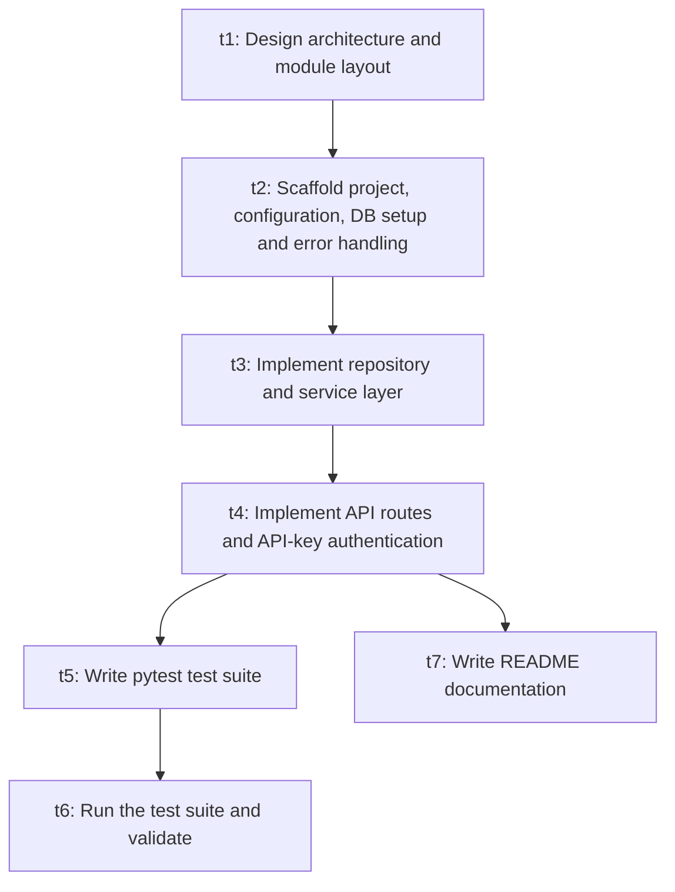

# Engineering plan

- Plan id: `plan_f869d00cb4`
- Workflow: `workflow_f35852877272`
- Specification: `spec_28dc61c510`
- Status: `plan_approved`
- Created: `2026-11-03T04:33:11.307509+00:00`

## Summary

Plan for a FastAPI + SQLAlchemy/SQLite URL shortener with click analytics, expiration, soft delete and API-key-protected management endpoints. Starts with architecture and scaffolding, then builds persistence and service logic, then the API layer. Tests are authored by a developer task and run by a testing task, with documentation written in parallel.

## Tasks

```text
t1: Design architecture and module layout
  depends_on: (none)
  agent: architecture  status: pending
t2: Scaffold project, configuration, DB setup and error handling
  depends_on: t1
  agent: developer  status: pending
t3: Implement repository and service layer
  depends_on: t2
  agent: developer  status: pending
t4: Implement API routes and API-key authentication
  depends_on: t3
  agent: developer  status: pending
t5: Write pytest test suite
  depends_on: t4
  agent: developer  status: pending
t6: Run the test suite and validate
  depends_on: t5
  agent: testing  status: pending
t7: Write README documentation
  depends_on: t4
  agent: documentation  status: pending
```

## Dependency graph (Mermaid)



## Ready set (initial)

- `t1` — Design architecture and module layout

## Parallel cohorts (simulated)

- Cohort 0: `t1`
- Cohort 1: `t2`
- Cohort 2: `t3`
- Cohort 3: `t4`
- Cohort 4: `t5`, `t7`
- Cohort 5: `t6`
