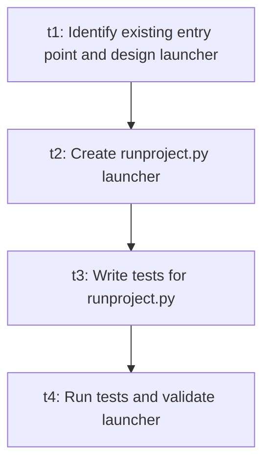

# Engineering plan

- Plan id: `plan_bbf60b3f17`
- Workflow: `workflow_d8505bc55d5a`
- Specification: `spec_8b186bd7e0`
- Status: `plan_approved`
- Created: `2026-11-03T05:02:52.845511+00:00`

## Summary

Locate the project's existing entry point, create a minimal runproject.py launcher in the project root with a __main__ guard that delegates to it and propagates the exit status, add tests for import-safety and launch behavior, then run validation.

## Tasks

```text
t1: Identify existing entry point and design launcher
  depends_on: (none)
  agent: architecture  status: pending
t2: Create runproject.py launcher
  depends_on: t1
  agent: developer  status: pending
t3: Write tests for runproject.py
  depends_on: t2
  agent: developer  status: pending
t4: Run tests and validate launcher
  depends_on: t3
  agent: testing  status: pending
```

## Dependency graph (Mermaid)



## Ready set (initial)

- `t1` — Identify existing entry point and design launcher

## Parallel cohorts (simulated)

- Cohort 0: `t1`
- Cohort 1: `t2`
- Cohort 2: `t3`
- Cohort 3: `t4`
